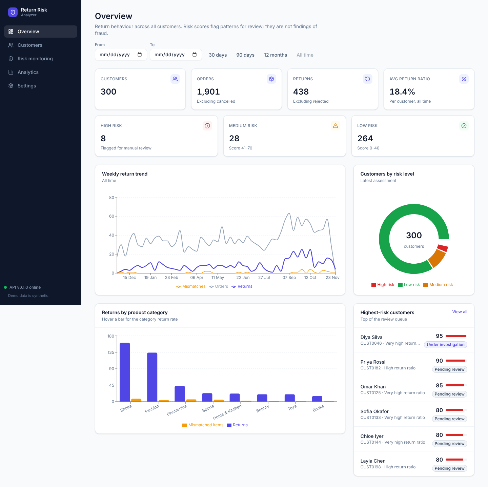

# Customer Return Risk Analyzer for E-commerce

A decision-support tool that analyses customer return history, gives every customer an explainable risk score from 0 to 100, and provides a SaaS-style dashboard for administrators to monitor, investigate and review risky return behaviour.

> **A high score marks behaviour worth reviewing. It does not establish that a customer committed fraud.**
> All sample data and ML results in this project are **synthetic demonstration data**.



## Features

- **Rule-based risk engine**: 10 configurable rules in 5 capped groups, minimum-evidence gates, a plain-language reason for every point, versioned rules, stored score history. See [docs/scoring.md](docs/scoring.md).
- **Dashboard**: summary cards, return trend, risk donut, category chart, top risk queue, date-range filter.
- **Customer directory**: search by ID or name, filter by risk level, category, return ratio above 30% and score above 70, sort any column, pagination, CSV export.
- **Customer investigation**: factor breakdown, score history, return timeline, return and order history with fast/vague/mismatch flags, ML estimate, manual review with audit trail.
- **Risk monitoring**: high-risk queue, review statuses (Pending review, Under investigation, Reviewed, Escalated), audit trail.
- **Analytics**: daily/weekly trends, returns by category, return reasons (vague vs explained), return-ratio distribution, risk distribution, ML evaluation.
- **Machine learning**: Logistic Regression and Decision Tree, leakage-safe pipeline, measured metrics, prediction API, rule engine kept as baseline and fallback. See [docs/ml.md](docs/ml.md).
- **Settings**: edit thresholds, weights and caps (saved as a new version, rescoring everyone), restore defaults, all-or-nothing CSV import, rescore all, optional email alerts.

## Tech stack

| Layer | Technology |
| --- | --- |
| Frontend | React 19, Vite, TypeScript, Tailwind CSS v4, React Router, Axios, Recharts, Lucide React |
| Backend | Python 3.11+, FastAPI, Pydantic v2, SQLAlchemy 2, Uvicorn |
| Database | PostgreSQL 15+, Alembic |
| ML | pandas, NumPy, scikit-learn, joblib |
| Testing | pytest, httpx, Vitest, Testing Library, Playwright |

Extras beyond the requested stack, and why: `pydantic-settings` (reads `.env`), `PyYAML` (default rules file), `python-multipart` (CSV upload), `ruff` (lint), Vitest + Testing Library (frontend unit tests, share Vite config), Playwright (end-to-end test). Email alerts use Python's standard `smtplib`.

## Quick start

Prerequisites: Python 3.11+, Node.js 20+, and PostgreSQL 15+ **or** Docker.

### 1. Database

```bash
docker compose up -d
```

Or, with a local PostgreSQL:

```sql
CREATE USER rra_user WITH PASSWORD 'rra_password';
CREATE DATABASE return_risk OWNER rra_user;
CREATE DATABASE return_risk_test OWNER rra_user;  -- for integration tests
```

(With Docker, create the test database once: `docker exec -it return-risk-db psql -U rra_user -d return_risk -c "CREATE DATABASE return_risk_test"`.)

### 2. Backend

```bash
cd backend
python -m venv .venv
source .venv/bin/activate            # Windows: .venv\Scripts\Activate.ps1
pip install -r requirements-dev.txt
cp .env.example .env                 # Windows: copy .env.example .env

alembic upgrade head                 # create the schema
python -m scripts.seed               # synthetic demo data + scores (seed 42, 300 customers)
python -m scripts.train              # train and evaluate the ML models
uvicorn app.main:app --reload --port 8000
```

API docs: http://localhost:8000/docs

### 3. Frontend

```bash
cd frontend
npm install
cp .env.example .env.local           # Windows: copy .env.example .env.local
npm run dev
```

Open http://localhost:5173.

## Demo script (5 minutes)

1. **Overview**: 300 customers; 8 high, 28 medium, 264 low risk (default seed). Click **30 days** to see the cards and charts follow the date range.
2. **Customers**: tick **Risk score above 70**, sort by **Return %**, search `CUST0046`, then **View profile**.
3. **Customer detail**: walk through the factor breakdown (each point explained, capped factors shown at +0), the return timeline and flagged returns. Click **Run model** to compare the ML probability with the rule score.
4. **Change status** to *Under investigation* with a note; the audit trail updates.
5. **Risk monitoring**: filter by review status; **Export high-risk CSV**.
6. **Analytics**: switch Daily/Weekly; show return reasons and the ML evaluation table with its synthetic-data warning.
7. **Settings**: disable *Item mismatch history*, enter your name, **Save and rescore**; the customer's score and rule version change. **Restore defaults** afterwards.

There is no login in this build (see Known limitations); reviewers type their name, which is stored in the audit trail.

## Testing

```bash
cd backend && pytest -q && ruff check .      # 49 tests (integration tests need return_risk_test)
cd frontend && npm test && npm run lint && npm run build
cd frontend && npx playwright install chromium && npm run e2e   # needs both servers running and seeded data
```

Latest results and the bug-fix log: [docs/testing.md](docs/testing.md).

## Configuration

| File | Variable | Purpose |
| --- | --- | --- |
| backend/.env | `DATABASE_URL` | PostgreSQL URL |
| backend/.env | `CORS_ORIGINS` | Allowed frontend origins (comma-separated) |
| backend/.env | `SCORING_AS_OF` | Optional fixed "today" for scoring (YYYY-MM-DD) |
| backend/.env | `MODEL_DIR` | Folder for `model.joblib` and `metrics.json` |
| backend/.env | `SMTP_*`, `ALERT_EMAIL_*` | Optional high-risk email alerts (off when `SMTP_HOST` is empty) |
| backend tests | `TEST_DATABASE_URL` | Integration test database (default `return_risk_test`) |
| frontend/.env.local | `VITE_API_BASE_URL` | Backend URL |

Seed options: `python -m scripts.seed --seed 7 --customers 400 --as-of 2026-11-24`.

## Project structure

```
.
├── docker-compose.yml           PostgreSQL for development
├── docs/                        architecture, scoring, ML, API, testing, screenshots, OpenAPI, Postman
├── backend/
│   ├── alembic/                 migrations
│   ├── app/
│   │   ├── main.py              app, CORS, error envelope
│   │   ├── config.py, db.py, deps.py
│   │   ├── models/              SQLAlchemy entities and enums
│   │   ├── schemas/             Pydantic request/response models
│   │   ├── routers/             health, customers, risk, analytics, reviews, ml, data, settings
│   │   ├── services/            business logic and SQL
│   │   ├── scoring/             features, rules, engine, config (pure Python)
│   │   └── ml/                  feature mapping and predictor
│   ├── scoring_config.yaml      default rules
│   ├── scripts/                 generate_data, seed, train, export_api_docs
│   ├── ml_artifacts/            trained model + metrics (generated)
│   └── tests/                   unit/ and integration/
└── frontend/
    ├── e2e/smoke.mjs            Playwright end-to-end test
    └── src/
        ├── api/                 Axios client and endpoint functions
        ├── types/api.ts         TypeScript mirrors of the API schemas
        ├── hooks/               useApi, useDebounce
        ├── components/          layout, ui, charts, review panel
        ├── pages/               Overview, Customers, Customer detail, Monitoring, Analytics, Settings
        └── lib/format.ts        formatters and design tokens
```

## Documentation

- [Architecture, data flow, ER diagram](docs/architecture.md)
- [Risk scoring algorithm](docs/scoring.md)
- [Machine learning pipeline and results](docs/ml.md)
- [API reference](docs/api.md) · [OpenAPI](docs/openapi.json) · [Postman collection](docs/api.postman_collection.json)
- [Testing report](docs/testing.md)

## Deployment

The project runs locally as described above. For a single-server deployment:

1. Provision PostgreSQL and set `DATABASE_URL`, `CORS_ORIGINS` (your frontend origin) and `APP_ENV=production`.
2. Backend: `pip install -r requirements.txt && alembic upgrade head`, then run `uvicorn app.main:app --host 0.0.0.0 --port 8000 --workers 2` behind a reverse proxy (nginx, Caddy) with HTTPS.
3. Frontend: `VITE_API_BASE_URL=https://api.example.com npm run build` and serve `frontend/dist/` as static files, with all unknown paths rewritten to `index.html` (client-side routing).
4. Add authentication before exposing it on the internet (see limitations).

## Known limitations

- **No authentication or roles.** Anyone who can reach the app can change review statuses and rules. Reviewer names are typed, not verified.
- **Synthetic data only.** Rules thresholds and ML results are tuned on generated data; the ML scores are optimistic (small test set, and the models partly learn quirks of the generator).
- One product per order line; multi-item orders would need an `order_items` table.
- The scoring date defaults to today, so 90-day windows move over time unless `SCORING_AS_OF` is set.
- Email alerts are fire-and-forget (no retry queue).

## Future scope

Authentication with roles (analyst, admin) · multi-item orders · scheduled nightly rescoring · model calibration and drift monitoring on real labelled outcomes · SHAP-style per-customer ML explanations · reviewer assignment and SLAs · webhook/Slack alerts.
