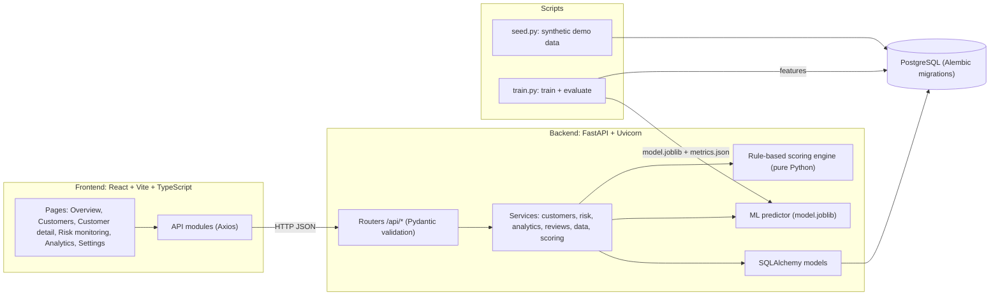
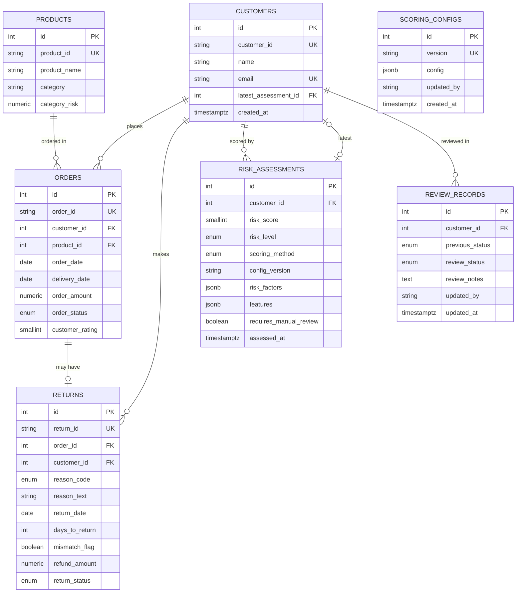

# Architecture

A three-tier application. A React single-page dashboard calls a FastAPI backend over JSON. The backend keeps business logic in a service layer and reads and writes PostgreSQL through SQLAlchemy. The scoring engine and the ML predictor are plain Python packages that the services call, so neither depends on HTTP or the database.

## Data flow

1. **Load.** `scripts/seed.py` (or `POST /api/data/import`) writes customers, products, orders and returns. Constraints reject a return on another customer's order and negative windows; the import validates every row first and is all-or-nothing.
2. **Category risk.** `products.category_risk` is recomputed as each category's observed return rate.
3. **Features.** `app/scoring/features.py` turns one customer's orders and returns into `CustomerFeatures`.
4. **Score.** `app/scoring/engine.py` applies the rules with group caps and returns a score, level and factor list.
5. **Store.** Each result is a new `risk_assessments` row; `customers.latest_assessment_id` points at the newest. Older rows are the score history.
6. **Serve.** List, analytics and monitoring endpoints read stored assessments, so sorting by score is one indexed query.
7. **Review.** Status changes append `review_records` rows (the audit trail). A customer who newly becomes HIGH is queued as `PENDING_REVIEW` by `system`, and an optional email alert is sent.
8. **ML.** `scripts/train.py` trains on the same features and writes `ml_artifacts/`. The API loads the model on demand; without it, ML endpoints return 503/404 and everything else keeps working.

### Key decisions

| Decision | Why | Alternative |
| --- | --- | --- |
| Store score snapshots instead of computing on read | History, fast sort/filter, a record of what a reviewer saw | Compute on read: always fresh, but slow and no history |
| Scoring engine has no DB/web imports | Rules can be changed and unit-tested alone | Rules inside services: harder to test |
| Rules versioned in `scoring_configs` | Every assessment records the rule version it used | Editing a file in place loses the history |
| Append-only `review_records` | The table is the audit trail | A status column: loses who changed what |
| Labels for ML from the generator, not from rule scores | Avoids a model that only copies the rules | Training on rule output (circular) |

## Database

Integrity rules enforced in the database (see `alembic/versions/`):

- `returns (order_id, customer_id)` references `orders (id, customer_id)`: a return must belong to its own customer's order. `returns.order_id` is unique (one return per order line).
- `CHECK` constraints: `risk_score` 0–100, `customer_rating` 1–5, `days_to_return >= 0`, `delivery_date >= order_date`, `DELIVERED` orders have a delivery date, amounts non-negative, `category_risk` 0–1.
- All foreign keys `ON DELETE RESTRICT` (history cannot be orphaned).
- Indexes on customer and date columns, `reason_code`, `risk_level`, `risk_score`, and `(customer_id, assessed_at)` / `(customer_id, updated_at)` for history.

`return_date >= delivery_date` spans two tables, so the import service validates it and an integration test checks every seeded return.
