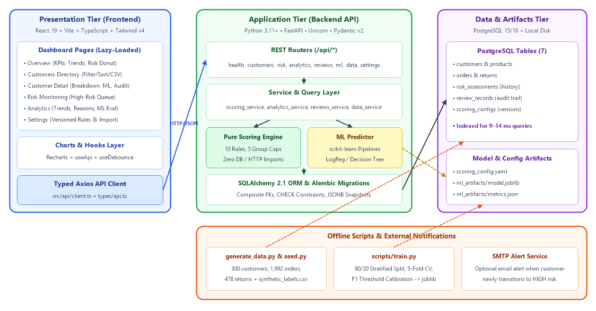
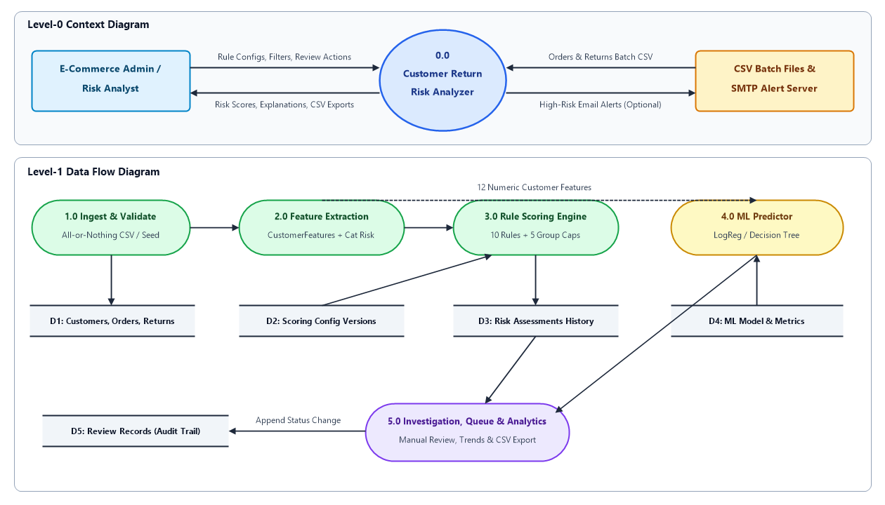
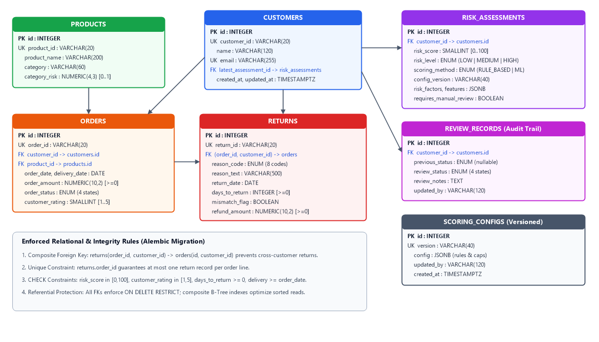
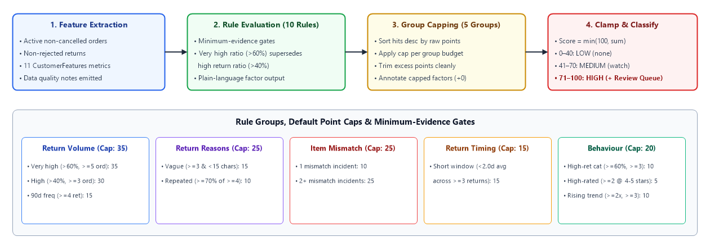
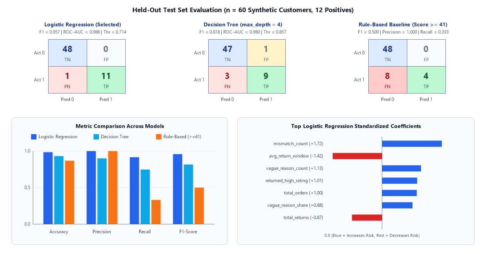

# Customer Return Risk Analyzer for E-commerce

> **B.Tech. Summer Internship Project Report** — Birla Institute of Technology, Mesra, Ranchi, Jharkhand-835215  
> **Editable Microsoft Word Version:** [`Customer_Return_Risk_Analyzer_Report.docx`](Customer_Return_Risk_Analyzer_Report.docx)

---

## Front Matter Placeholders

- **Project Title:** Customer Return Risk Analyzer for E-commerce
- **Degree:** Bachelor of Technology in Computer Science and Engineering
- **Student Name:** `<Name of the Student>`
- **Roll No.:** `<Roll No. of the Student>`
- **Organization / Company:** `<Organization / Company>`
- **Guide Name & Designation:** `<Name of the Guide>`, `<Designation of the Guide>`

---

## ABSTRACT

Product returns in e-commerce create substantial reverse-logistics and refund-leakage costs, while aggressive automated blocking risks alienating legitimate shoppers. This project presents the Customer Return Risk Analyzer for E-commerce, a full-stack decision-support platform that evaluates customer return histories, assigns each account an explainable risk score from 0 to 100, and supports human investigators through a structured review workflow. A high score highlights patterns warranting review rather than establishing confirmed fraud.

The system follows a three-tier architecture combining a React and TypeScript dashboard, a FastAPI service layer, and a PostgreSQL database managed via Alembic migrations. A pure Python scoring engine extracts eleven behavioral features and evaluates ten configurable rules organized into five capped groups with minimum-evidence gates, generating plain-language explanations and versioned score snapshots. Alongside the rule engine, a leakage-safe scikit-learn pipeline trains Logistic Regression and Decision Tree classifiers on synthetic demonstration data derived from six behavioral customer profiles.

Across 300 seeded synthetic customers (1,992 orders and 478 returns), the rule engine flagged 8 high-risk, 28 medium-risk, and 264 low-risk accounts. On the held-out test set, Logistic Regression achieved 0.983 accuracy, 1.000 precision, 0.917 recall, and 0.957 F1-score, outperforming the conservative rule baseline (0.500 F1). All 49 backend tests, 11 frontend unit tests, and 10 end-to-end checks passed, confirming reliable operation for transparent return-risk triage.

---

## ACKNOWLEDGEMENT

I would like to express my sincere gratitude to my project guide, `<Name of the Guide>`, `<Designation of the Guide>`, Department of Computer Science and Engineering, Birla Institute of Technology, Mesra, for their continuous guidance, valuable technical insights, and encouragement throughout the course of this summer internship project.

I am deeply thankful to the Head of the Department of Computer Science and Engineering and all faculty members of Birla Institute of Technology, Mesra, for providing a strong academic foundation and the resources necessary to complete this work. I also extend my appreciation to my mentors and colleagues at `<Organization / Company>` for their constructive feedback during system design, testing, and evaluation.

Finally, I am grateful to my parents, classmates, and laboratory staff for their constant support, patience, and motivation throughout the development and documentation of this project.

---

## CONTENTS

- **CHAPTER 1: INTRODUCTION** (1.1 Overview, 1.2 Problem Statement, 1.3 Objectives, 1.4 Scope and Responsible-Use Principles, 1.5 Organization of the Report)
- **CHAPTER 2: LITERATURE REVIEW** (2.1 E-Commerce Product Returns and Refund Abuse, 2.2 Rule-Based vs. Machine Learning Detection Approaches, 2.3 Class Imbalance and Evaluation Metrics, 2.4 Interpretability and Human-in-the-Loop Review, 2.5 Summary and Identified Gap)
- **CHAPTER 3: METHODOLOGY** (3.1 System Architecture and Technology Stack, 3.2 Data Flow Diagrams, 3.3 Database Schema and Integrity Constraints, 3.4 Synthetic Dataset Description and Behavioural Profiles, 3.5 Behavioural Feature Extraction, 3.6 Group-Capped Rule-Based Scoring Engine, 3.7 Leakage-Safe Machine Learning Pipeline, 3.8 REST API and Frontend Dashboard Design, 3.9 Core Implementation Snippets)
- **CHAPTER 4: EXPERIMENTAL RESULTS AND DISCUSSION** (4.1 Seeded Cohort Risk Distribution, 4.2 Customer Risk Investigation Case Study, 4.3 Machine Learning Evaluation and Baseline Comparison, 4.4 Feature Importance and Model Interpretability, 4.5 Web Application Interface Walkthrough, 4.6 Software Verification, Bug Fixes, and Performance)
- **CHAPTER 5: CONCLUSION** (5.1 Summary of Accomplished Work, 5.2 Known Limitations, 5.3 Future Scope)
- **REFERENCES**

---

## CHAPTER 1: INTRODUCTION

### 1.1 Overview
Rapid expansion in global e-commerce has made lenient return and refund policies a standard driver of customer acquisition and retention. However, generous return windows and frictionless refunds also expose online merchants to systematic return abuse, including wardrobing (purchasing items for short-term use before returning them), serial returning with vague defect claims, and item-mismatch returns [1], [4].

The Customer Return Risk Analyzer for E-commerce is a full-stack decision-support application designed to evaluate customer-level order and return histories, compute an interpretable risk score on a 0 to 100 scale, and provide risk analysts with an interactive investigation and review dashboard.

### 1.2 Problem Statement
E-commerce operations teams face two conflicting risks when managing product returns: unchecked serial abuse erodes profit margins and inflates reverse-logistics costs, while naive heuristics (e.g., flagging one-time fast returns or high-return apparel buyers) generate excessive false positives. Analysts require a transparent platform that prevents correlated signals from double-counting, enforces minimum-evidence gates, supports versioned rule governance, and records an immutable review audit trail.

### 1.3 Objectives
- **Pure Explainable Rule Engine:** 10 configurable rules across 5 capped behavioral groups with plain-English justifications.
- **Relational Integrity and Score History:** PostgreSQL schema via Alembic storing score history, versioned configs, and an append-only audit trail.
- **Leakage-Safe ML Extension:** Logistic Regression and Decision Tree classifiers trained on synthetic behavioral profiles with training-fold F1 threshold calibration.
- **Interactive Dashboard:** React 19 + TypeScript UI for KPIs, directory filtering, customer investigation, monitoring queue, analytics, and settings.
- **Rigorous Verification:** Automated unit, PostgreSQL integration, lint, type-check, and Playwright E2E tests.

### 1.4 Scope and Responsible-Use Principles
The system is strictly scoped as a human-in-the-loop decision-support tool. High scores prompt human review and never establish fraud. All sample data and ML labels are synthetically generated for demonstration.

### 1.5 Organization of the Report
Chapter 2 covers the literature review; Chapter 3 presents system architecture, DFDs, database design, synthetic dataset, algorithms, and ML pipeline; Chapter 4 reports results, case studies, UI walkthroughs, and testing; Chapter 5 concludes with limitations and future work.

---

## CHAPTER 2: LITERATURE REVIEW

### 2.1 E-Commerce Product Returns and Refund Abuse
Samorani et al. [1] modeled longitudinal "product return episodes" across purchase-and-return sequences rather than isolated transactions. Akturk et al. [2] analyzed technology-enabled countermeasures against return abuse such as customer-level tracking and targeted review policies, while the ECR Retail Loss Research Group [3] showed that blunt penalties provoke legitimate customer backlash.

### 2.2 Rule-Based vs. Machine Learning Detection Approaches
Mutemi and Bacao [4] systematically reviewed e-commerce fraud detection methods, contrasting transparent deterministic rules against supervised ML classifiers. Pairing an explainable rule baseline with an independent ML probability estimate combines auditability with multivariate pattern recognition.

### 2.3 Class Imbalance and Evaluation Metrics
Because suspicious returners form a minority class, accuracy is misleading. Saito and Rehmsmeier [5] demonstrated that Precision-Recall and F1 optimization are essential under class imbalance, motivating balanced class weights and training-fold F1 threshold tuning [6].

### 2.4 Interpretability and Human-in-the-Loop Review
Duong et al. [7] demonstrated that exposing feature attributions in online return prediction helps operations teams justify review decisions and iterate on policy thresholds.

### 2.5 Summary and Identified Gap
This project bridges the gap between isolated offline ML scripts and production-grade decision-support tools by combining group-capped rules, database-enforced constraints, versioned rule history, and human-in-the-loop audit trails.

---

## CHAPTER 3: METHODOLOGY

### 3.1 System Architecture and Technology Stack

| Layer | Technologies & Versions | Primary Responsibility |
| --- | --- | --- |
| Frontend | React 19.3, TypeScript 7, Vite 8, Tailwind CSS v4, React Router 7, Axios, Recharts 3, Lucide React | Interactive SaaS dashboard, lazy-loaded routes, charts, filters, CSV upload/export |
| Backend API | Python 3.11+, FastAPI 0.165, Uvicorn 0.54, Pydantic v2, pydantic-settings, PyYAML, python-multipart | REST endpoints, schema validation, error envelopes, service orchestration, SMTP alerts |
| Database & ORM | PostgreSQL 15/16, SQLAlchemy 2.1, psycopg 3.3, Alembic 1.20 | Relational storage, schema migrations, JSONB snapshots, composite constraints |
| Machine Learning | pandas 3.1, NumPy 2.5, scikit-learn 1.9, joblib 1.6 | Feature preprocessing pipelines, Logistic Regression & Decision Tree training/inference |
| Testing & QA | pytest, httpx, ruff, Vitest, Testing Library, oxlint, Playwright | Unit, integration, API contract, static lint, and headless browser E2E verification |

### 3.2 Data Flow Diagrams

### 3.3 Database Schema and Integrity Constraints

### 3.4 Synthetic Dataset Description and Behavioural Profiles
Seeded with `seed=42`, `n_customers=300`, `as_of=2026-11-24`: 48 products across 8 categories, 1,992 orders (`DELIVERED`: 1,891, `CANCELLED`: 91, `SHIPPED`: 10), and 478 returns (`REFUNDED`: 310, `APPROVED`: 76, `REQUESTED`: 52, `REJECTED`: 40; 43 `mismatch_flag=True`; 267 with `reason_text=None`).

| Profile | Target Share | Actual Count | Suspicious Label | Orders | Return Prob. | Window (Days) | Mismatch Prob. |
| --- | --- | --- | --- | --- | --- | --- | --- |
| `ordinary` | 50% | 146 | 0 | 2–9 | 0.02–0.09 | 3–20 | 0.01 |
| `frequent_honest` | 16% | 47 | 0 | 6–14 | 0.18–0.32 | 2–14 | 0.02 |
| `new_customer` | 14% | 47 | 0 | 1–2 | 0.10–0.30 | 2–15 | 0.02 |
| `wardrober` | 8% | 21 | 1 | 7–15 | 0.42–0.65 | 0–3 | 0.05 |
| `vague_serial_returner` | 7% | 24 | 1 | 7–15 | 0.35–0.55 | 1–8 | 0.08 |
| `mismatch_abuser` | 5% | 15 | 1 | 6–13 | 0.28–0.45 | 1–6 | 0.55 |

Observed `category_risk`: Shoes (`0.425`), Fashion (`0.405`), Electronics (`0.232`), Sports (`0.148`), Home & Kitchen (`0.144`), Beauty (`0.134`), Toys (`0.114`), Books (`0.081`).

### 3.5 Behavioural Feature Extraction
Equations (3.1)–(3.3):
- `(3.1)` $R_i = \min(1.0, N_{\text{ret},i} / N_{\text{ord},i})$ for $N_{\text{ord},i} > 0$
- `(3.2)` $T_i = (N_{90\text{d},i}/3) / (N_{90\text{--}365\text{d},i}/9)$ for $N_{90\text{--}365\text{d},i} > 0$
- `(3.3)` $\bar{W}_i = \frac{1}{|V_i|} \sum_{k \in V_i} d_k$ where $d_k = \text{return\_date}_k - \text{delivery\_date}_k \ge 0$

### 3.6 Group-Capped Rule-Based Scoring Engine

Equation (3.4):
- `(3.4)` $S_i = \min\left(100, \sum_{g \in G} \min\left(C_g, \sum_{h \in H_g} \text{points}(h)\right)\right)$

### 3.7 Leakage-Safe Machine Learning Pipeline
80/20 stratified customer split (240 train / 60 test, 20% positives, seed 42), `SimpleImputer(strategy="median", add_indicator=True)`, `StandardScaler`, `class_weight="balanced"`, 5-fold CV F1, and training-fold F1 threshold selection.

### 3.8 REST API and Frontend Dashboard Design
25+ endpoints under `/api/*` with uniform error envelopes (`error.code`, `error.message`, `error.details`), OpenAPI 3.1 spec, and 6 lazy-loaded React pages.

---

## CHAPTER 4: EXPERIMENTAL RESULTS AND DISCUSSION

### 4.1 Seeded Cohort Risk Distribution
300 customers: **264 LOW (88.0%)**, **28 MEDIUM (9.3%)**, **8 HIGH (2.7%)**; 1,901 active orders, 438 counted returns, 18.4% average return ratio.

### 4.2 Customer Risk Investigation Case Study (`CUST0046`)
Diya Silva (`CUST0046`) scored **95/100 (HIGH)**: Very high return ratio (+35), Vague reasons (+15), Short return window (+15), Item mismatch (+10), High-return categories (+10), Rising return rate (+10), while High return frequency (+15 raw) and Returned items rated highly (+5 raw) were capped at `+0`. ML Logistic Regression probability: **100.0%**.

### 4.3 Machine Learning Evaluation and Baseline Comparison

| Model | Threshold | Accuracy | Precision | Recall | F1 | ROC-AUC | 5-Fold CV F1 | TN / FP / FN / TP |
| --- | --- | --- | --- | --- | --- | --- | --- | --- |
| Logistic Regression (Selected) | 0.7139 | 0.9833 | 1.0000 | 0.9167 | 0.9565 | 0.9861 | 0.8838 ± 0.057 | 48 / 0 / 1 / 11 |
| Decision Tree (`max_depth=4`) | 0.8571 | 0.9333 | 0.9000 | 0.7500 | 0.8182 | 0.9800 | 0.8381 ± 0.061 | 47 / 1 / 3 / 9 |
| Rule-Based Baseline (`score >= 41`) | 41 pts | 0.8667 | 1.0000 | 0.3333 | 0.5000 | — | — | 48 / 0 / 8 / 4 |

### 4.4 Feature Importance and Model Interpretability
Top LR coefficients: `mismatch_count` (+1.7227), `avg_return_window` (-1.4167), `vague_reason_count` (+1.1250), `returned_high_rating_count` (+1.0107), `total_orders` (+0.9989), `vague_reason_share` (+0.8752), `total_returns` (-0.8658). Top Decision Tree Gini importances: `vague_reason_share` (0.8088), `avg_return_window` (0.1211), `total_orders` (0.0459).

### 4.5 Web Application Interface Walkthrough
Screenshots included in the `.docx` report: [`01-overview.png`](../screenshots/01-overview.png), [`02-customers.png`](../screenshots/02-customers.png), [`03-customer-detail.png`](../screenshots/03-customer-detail.png), [`04-monitoring.png`](../screenshots/04-monitoring.png), [`05-analytics.png`](../screenshots/05-analytics.png), [`06-settings.png`](../screenshots/06-settings.png).

### 4.6 Software Verification, Bug Fixes, and Performance
- **Backend:** 49 passed (`27` unit, `5` health/config, `17` PostgreSQL integration), `ruff check .` clean.
- **Frontend:** 11 passed (`npm test`), `oxlint` & `tsc`/`vite build` clean.
- **Playwright E2E:** 10/10 steps passed with 0 console errors.
- **Performance:** Full 300-customer rescore in 0.6 s; core API endpoints respond in 9–14 ms.

---

## CHAPTER 5: CONCLUSION

### 5.1 Summary of Accomplished Work
Delivered a complete, explainable, auditable three-tier Customer Return Risk Analyzer combining a group-capped rule engine, PostgreSQL relational constraints, React investigation UI, and leakage-safe ML evaluation.

### 5.2 Known Limitations
No authentication/RBAC, synthetic demonstration data only, single-product order lines, sliding 90-day reference window unless `SCORING_AS_OF` is set, and fire-and-forget SMTP alerts.

### 5.3 Future Scope
OAuth2/JWT RBAC, real-label retraining with PSI drift monitoring and calibration, per-customer SHAP explanations, multi-item `order_items` schema, scheduled nightly rescoring, and Slack/webhook alerts.

---

## REFERENCES

1. Samorani, M., Alptekinoğlu, A. and Messinger, P.R., 2019. Product return episodes in retailing. *Service Science*, 11(4), pp.263–278. DOI: 10.1287/serv.2019.0250.
2. Akturk, M.S., Ketzenberg, M. and Yıldız, B., 2021. Managing consumer returns with technology-enabled countermeasures. *Omega*, 102, p.102337. DOI: 10.1016/j.omega.2020.102337.
3. ECR Retail Loss Research Group, 2024. Consumer perspectives on interventions to combat fraudulent product returns in omnichannel fashion retail. *International Journal of Physical Distribution & Logistics Management*. DOI: 10.1108/IJPDLM-02-2024-0090.
4. Mutemi, A. and Bacao, F., 2024. E-commerce fraud detection based on machine learning techniques: Systematic literature review. *Big Data Mining and Analytics*, 7(2), pp.419–444.
5. Saito, T. and Rehmsmeier, M., 2015. The precision-recall plot is more informative than the ROC plot when evaluating binary classifiers on imbalanced datasets. *PLoS ONE*, 10(3), p.e0118432.
6. Pedregosa, F. et al., 2011. Scikit-learn: Machine learning in Python. *Journal of Machine Learning Research*, 12, pp.2825–2830.
7. Duong, Q.H., Zhou, L., Nguyen, T.V. and Meng, M., 2025. Understanding and predicting online product return behavior: An interpretable machine learning approach. *International Journal of Production Economics*, 280, p.109499. DOI: 10.1016/j.ijpe.2024.109499.
8. Ramírez, S., 2024. *FastAPI: Modern, fast web framework for building APIs with Python*. https://fastapi.tiangolo.com/.
9. PostgreSQL Global Development Group, 2024. *PostgreSQL 16 Documentation*. https://www.postgresql.org/docs/16/.
10. Bayer, M., 2024. *SQLAlchemy 2.0 and Alembic Documentation*. https://docs.sqlalchemy.org/.
